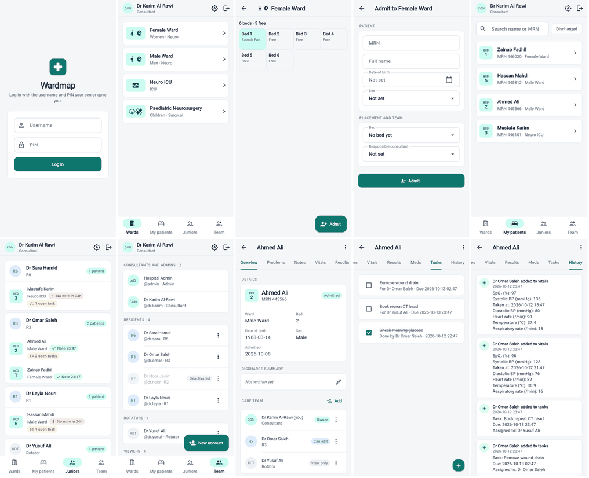
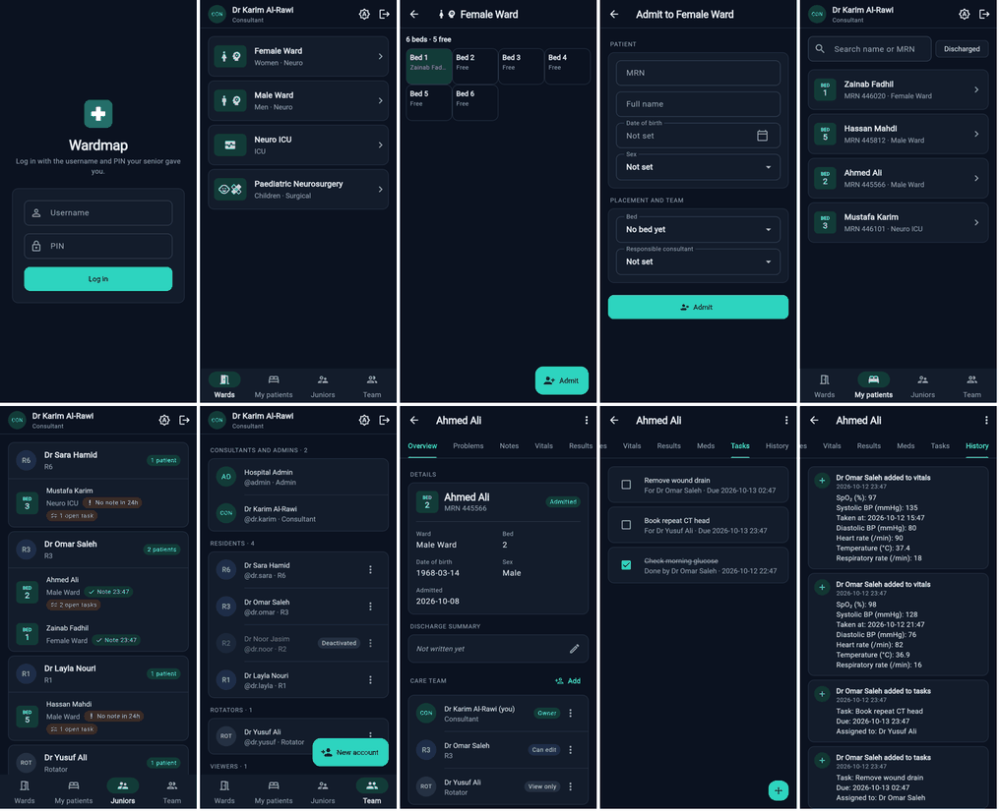

# Design system

How Wardmap looks, and the rules that keep every screen consistent. The
goal is calm and clinical: easy to read on a phone at the bedside, quick to
scan on a busy ward, and the same in light and dark.

Everything lives in two files:

| File | What's in it |
|---|---|
| [lib/theme.dart](../lib/theme.dart) | The tokens (colors, spacing, corners, type) and the light and dark themes built from them |
| [lib/components.dart](../lib/components.dart) | Shared building blocks: pills, avatars, cards, empty states |

Screens never hard-code a color, font size or gap; they use these. To change
the look of the whole app, change a token.

## Colors

Teal is the brand color. It is the same teal as "your patient" beds on the
floor plan, so it always means "yours" or "the main action". Everything else
is slate grey, so the few colored things stand out.

| Token | Light | Dark | Used for |
|---|---|---|---|
| Primary | `#0F766E` | `#2DD4BF` | Main buttons, selected tab, links, "your patient" |
| Primary container | `#CCFBF1` | `#123B38` | Bed badges, selected nav item, ward icons |
| Background | `#F4F6F8` | `#0B1220` | Behind everything |
| Surface | `#FFFFFF` | `#131C2B` | Cards, dialogs, inputs |
| Text | `#0F172A` | `#E2E8F0` | Main text |
| Muted text | `#475569` | `#94A3B8` | Labels, second lines, timestamps |
| Line | `#E2E8F0` | `#283548` | Card borders, dividers |

### Status tones

A status always uses one of six tones, so color means the same thing on
every screen. Each tone is a pale background with dark text (light mode) or
the reverse (dark mode).

| Tone | Means | Examples |
|---|---|---|
| `danger` | Needs attention now | "No note in 24h", errors |
| `warning` | Pending work | "2 open tasks" |
| `success` | Done or up to date | "Note 08:30", something added (History) |
| `info` | Neutral fact worth noticing | "Can edit", residents, changes (History) |
| `brand` | Yours / most senior | "Owner", "Admitted", consultants |
| `neutral` | Background fact | "Discharged", "Deactivated", rotators |

Every color pair passes the WCAG AA contrast ratio (4.5:1); a test
(`test/design_system_test.dart`) checks this, so a token change that makes
text hard to read fails CI.

## Type

Roboto (the system font on Android and the web app). Headings are bolder
than Material's defaults; body text has slightly taller lines for reading
notes.

| Style | Size / weight | Used for |
|---|---|---|
| `headlineMedium` | 28 / bold | Login title |
| `titleLarge` | 20 / semibold | Screen titles, the patient's name |
| `titleMedium` | 16 / semibold | Card titles (ward, patient, junior) |
| `bodyLarge` | 16 / regular | List text, field values |
| `bodyMedium` | 14 / regular | Second lines, notes |
| `bodySmall` | 12 / grey | Labels above values, timestamps |
| `labelMedium` | 12 / semibold | Pills, section headers (in capitals) |

## Spacing and shape

Spacing comes in steps of 4: `Space.xs` 4, `sm` 8, `md` 12, `lg` 16,
`xl` 24, `xxl` 32. Screens have 16 of padding at the edges; cards in a list
are 8 apart; fields in a form are 12 apart.

Corners: 8 for small things (bed badges, chips), 10 for inputs, 12 for cards
and buttons, 16 for dialogs and floating buttons. Cards have a thin border
instead of a shadow. Buttons are 48 tall so they are easy to tap with
gloves.

## Components

| Component | What it is | Where |
|---|---|---|
| `BrandMark` | The logo: white cross on a teal rounded square | Login |
| `StatusPill` | A short colored label with a tone | Juniors, care team, patients |
| `Notice` | A full-width message box with a tone | Login (logged out, wrong PIN), form errors |
| `RoleAvatar` | Round role badge ("CON", "R3") colored by seniority: consultants/admins teal, residents blue, others grey | Team, care team, Juniors, top bar |
| `BedBadge` | The bed number in a small tile at the start of a row | Patients, Juniors, patient details |
| `SectionHeader` | Small capitals heading over a group, with an optional action | Patient overview, Team, Admit |
| `InfoGrid` / `InfoItem` | Facts as label-over-value in two columns | Patient details |
| `CardList` | Cards in a scrolling column with even gaps | Wards, Patients, Juniors |
| `EmptyState` | Icon, title and hint when a list is empty or fails to load | Every list |
| `PickerField` | A date or time drawn like a text field | Admit, record forms |
| `Loading` | The spinner | Every list |
| `Readable` | Caps the width of a form on wide screens | Admit |

Standard Material widgets (buttons, inputs, tabs, dialogs, menus, snack
bars) are styled once in `theme.dart`, so a plain `FilledButton` already
looks right.

## Light and dark

The app follows the phone's setting by default. The appearance button (a sun with an A) in the top bar
switches between **Match phone**, **Light** and **Dark**; the choice is
remembered on that device.

Bed colors on the ward map come from the theme on this version. The
floor-plan look (paper floor, drawn beds) keeps its own fixed colors in both
modes, so it reads like a printed ward map.

## App icon

The web app's icons (`web/icons/`, `web/favicon.png`) are the same cross on
teal as `BrandMark`. The loading screen and the browser's address bar use
the background color, so there is no flash of blue while the app starts.

## Adding to it

- Need a color? Use `context.colors` (Material's color scheme) or
  `context.tones` (status tones). If neither fits, add a token in
  `theme.dart` for both light and dark rather than a one-off color.
- Need a gap? Use a `Space` step.
- Building something two screens will use? Put it in `components.dart` and
  add a row to the table above.
